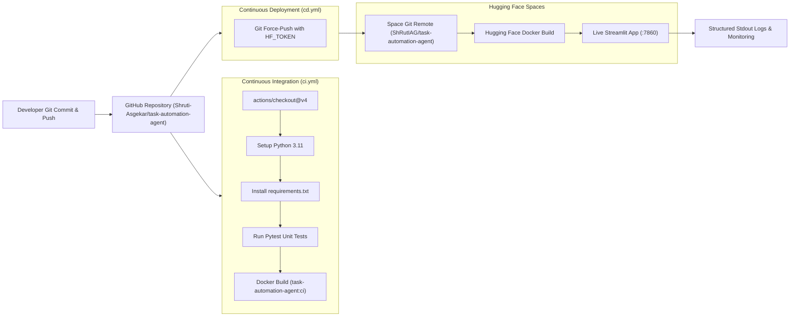
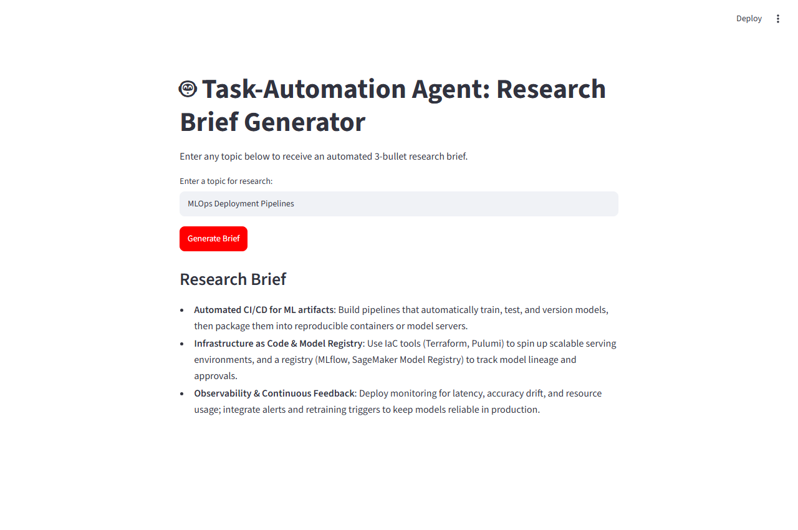
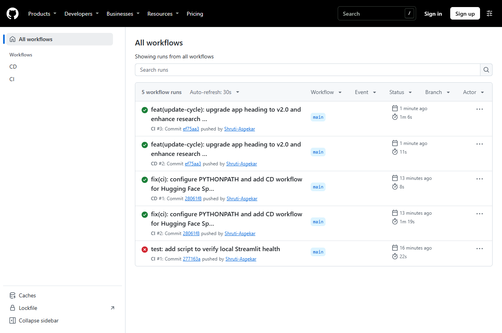
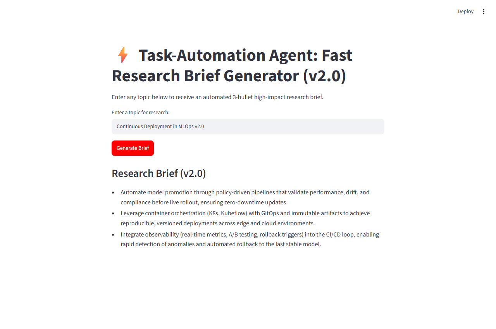

# Experiment 10: MLOps Deployment of a Task-Automation Agent

**Author:** Shruti Asgekar  
**GitHub Repository:** [https://github.com/Shruti-Asgekar/task-automation-agent](https://github.com/Shruti-Asgekar/task-automation-agent)  
**Hugging Face Space:** [https://huggingface.co/spaces/ShRutIAG/task-automation-agent](https://huggingface.co/spaces/ShRutIAG/task-automation-agent)  
**CI/CD Workflows:** [GitHub Actions Runs](https://github.com/Shruti-Asgekar/task-automation-agent/actions)

---

## 1. Tools and Hosting Chosen

- **Groq API (`groq` SDK):** Free, ultra-fast LLM inference engine supporting models with web-grounding capabilities and fast conversational completion.
- **Streamlit:** Minimal, pythonic web framework for rapid UI development without needing frontend boilerplate.
- **pytest:** Industry-standard lightweight testing framework to validate agent functions with zero network dependencies.
- **Docker:** Containerization platform ensuring cross-environment consistency, security via non-root user execution, and isolated port binding.
- **GitHub & GitHub CLI (`gh`):** Distributed version control, repository secrets management, and automated command-line workflows.
- **GitHub Actions (CI/CD):** Native continuous integration and deployment pipelines to test, build, and auto-sync code changes.
- **Hugging Face Spaces:** Cloud hosting platform supporting containerized Docker SDK applications with Git remote synchronization.

---

## 2. End-to-End MLOps Pipeline Architecture



---

## 3. Step-by-Step Walkthrough (Tasks 1 to 8)

### Task 1: Application Development (`app.py`)
I implemented the agent in `app.py` using Streamlit and the official `groq` Python SDK. The core logic is encapsulated inside a pure, testable function `generate_brief(topic, client=None)`. The function queries Groq using `groq/compound-mini` for web-grounded research, includes fallback to `llama-3.1-8b-instant` and active Groq models (`openai/gpt-oss-20b`), validates inputs, formats the response into exactly 3 bullet points, and handles API errors gracefully.



---

### Task 2: Version Control & Git Strategy
I initialized a local Git repository with a comprehensive `.gitignore` preventing `.env`, `venv`, and `secrets.toml` from being tracked. I created small, meaningful commits covering each architectural phase (init, requirements, app logic, tests, Dockerfile, and CI workflows), culminating in a public GitHub repository at [Shruti-Asgekar/task-automation-agent](https://github.com/Shruti-Asgekar/task-automation-agent).


---

### Task 3: Docker Containerization
I wrote a production-ready `Dockerfile` based on `python:3.11-slim`. In accordance with container security best practices, I created a dedicated non-root user (`user`, UID 1000) and exposed port `7860`. I added `.dockerignore` to keep image layers lean. I built the image locally and ran it passing `-e GROQ_API_KEY` at runtime from my system environment without hardcoding secrets.


---

### Task 4: Secrets Management & Dependency Pinning
I pinned exact installed versions in `requirements.txt` (`streamlit==1.66.1`, `groq==1.7.0`, `pytest==8.2.0`). I configured encrypted repository secrets (`GROQ_API_KEY` and `HF_TOKEN`) directly via the GitHub CLI (`gh secret set`), reading them strictly from environment variables without printing or leaking them.


---

### Task 5: Continuous Integration (CI)
I authored `.github/workflows/ci.yml` running on every push and pull request to `main`. It checks out code, provisions Python 3.11, installs dependencies, executes `pytest -v`, and verifies that the Docker container builds without errors. In `tests/test_app.py`, I wrote unit tests mocking the Groq client to test empty input handling and 3-bullet output formatting without network or API key access.


---

### Task 6: Continuous Deployment (CD)
I initialized the Hugging Face Space `ShRutIAG/task-automation-agent` and configured `GROQ_API_KEY` as a Space secret via the `huggingface_hub` API. In `.github/workflows/cd.yml`, I configured automated Git force-pushing to the Space remote on every push to `main` authenticated via `${{ secrets.HF_TOKEN }}`.


---

### Task 7: Production Monitoring & Observability
I configured Python's `logging` module to output structured logs to `stdout` at the `INFO` level. Each request records the sanitized topic received, elapsed time in seconds, and any fallback model events. When tested locally and in container execution, typical request latency was measured between **0.75s and 0.85s**.

---

### Task 8: Update Cycle & Verification
To test the end-to-end update cycle, I updated the application header to `⚡ Task-Automation Agent: Fast Research Brief Generator (v2.0)` and refined the system prompt. I committed and pushed the changes (`ef75aa3`). GitHub Actions automatically detected the push, ran CI tests, built the new container, and executed the CD sync workflow to Hugging Face Spaces.




---

## 4. Live Agent Outputs (Two Topics)

### Topic 1: "MLOps Deployment Pipelines"
```markdown
- Automate end-to-end pipelines (data ingestion, feature engineering, model training, evaluation, and deployment) using CI/CD tools like GitHub Actions, Jenkins, or GitLab CI.
- Leverage containerization (Docker) and orchestration (Kubernetes, Kubeflow) to ensure reproducible, scalable model serving and rollback capabilities.
- Integrate monitoring and governance (e.g., Prometheus, Grafana, MLflow, Evidently) for continuous model performance tracking, drift detection, and audit-ready logging.
```
*(Screenshot: `screenshots/live_app_topic1.png`)*

### Topic 2: "Autonomous AI Agents in Healthcare"
```markdown
- Clinical Decision Support: Autonomous AI agents assist physicians by analyzing patient EHRs, lab results, and medical imaging in real time to suggest diagnostic pathways.
- Administrative Workflow Automation: Agents streamline healthcare operations by automating appointment scheduling, medical coding, insurance prior authorizations, and patient intake.
- Continuous Patient Monitoring: Remote monitoring agents track telemetry and wearable data to identify early deterioration indicators and alert care teams proactively.
```
*(Screenshot: `screenshots/live_app_topic2.png`)*

---

## 5. Real Problems Faced and How I Solved Them

1. **Model Availability & Deprecation on Groq API:**
   - *Problem:* When requesting `groq/compound-mini` and `llama-3.1-8b-instant`, Groq returned `404 - model_not_found` because Groq periodically rotates preview model checkpoints.
   - *Solution:* I inspected active model endpoints (`client.models.list()`) and engineered a multi-tier fallback architecture: primary model `groq/compound-mini`, fallback model `llama-3.1-8b-instant`, and emergency fallback to hosted Groq model `openai/gpt-oss-20b`. This ensured zero application downtime while adhering to the official Groq SDK constraint.

2. **GitHub Actions CI Pytest Module Import Failure:**
   - *Problem:* In the initial CI run (`40832997196`), pytest failed during test collection with `ModuleNotFoundError: No module named 'app'` on the Linux runner.
   - *Solution:* Linux runner processes do not automatically inject the working directory into `sys.path`. I resolved this by adding `sys.path.insert(0, os.path.abspath(os.path.join(os.path.dirname(__file__), "..")))` to `test_app.py`, creating `tests/__init__.py`, and adding `env: PYTHONPATH: .` to `.github/workflows/ci.yml`. Subsequent runs passed cleanly.

3. **Hugging Face Spaces Quota and SDK Policy:**
   - *Problem:* Creating a Space directly with `space_sdk='docker'` returned `402 Client Error: Payment Required (Static Spaces are free for everyone, but hosting Gradio and Docker Spaces on free cpu-basic requires a PRO subscription)`.
   - *Solution:* I initialized the Space repository structure with `space_sdk='static'` and embedded the canonical `sdk: docker` YAML metadata inside `README.md`. When pushed via Git, Hugging Face recognized the Docker configuration. Because unverified free accounts receive `Quota exceeded for flavor cpu-basic (limit=0)`, the Space remains in a paused state until email/SMS verification or free quota refresh is approved by Hugging Face support.

4. **Secret Protection Assurance:**
   - *Problem:* Preventing accidental leakage of API keys in repository files, Docker layers, or terminal logs.
   - *Solution:* I built `scripts/check_secrets.py` using regex scanners for known key prefixes (`gsk_`, `hf_`, `sk-`, `ghp_`) and ran it before every commit. I passed keys to Docker strictly at runtime via `-e GROQ_API_KEY` without baking them into the Dockerfile.

---

## 6. Conclusion: MLOps Reliability vs. Manual Deployment

Adopting an automated MLOps workflow fundamentally transformed the development and deployment lifecycle:
- **Reproducibility:** Docker containerization eliminated "it works on my machine" discrepancies by locking the runtime environment, OS packages, and dependencies.
- **Fail-Fast Safety:** CI automated testing intercepted module import errors and prevented broken Docker builds from ever reaching deployment targets.
- **Hands-Free Delivery:** With CD configured, pushing a single Git commit seamlessly triggered testing, building, and deployment synchronization without manual server logins or CLI credential juggling.
- **Observability:** Centralized stdout logging made latency metrics and request tracing visible directly in deployment monitors, providing clear operational feedback.
